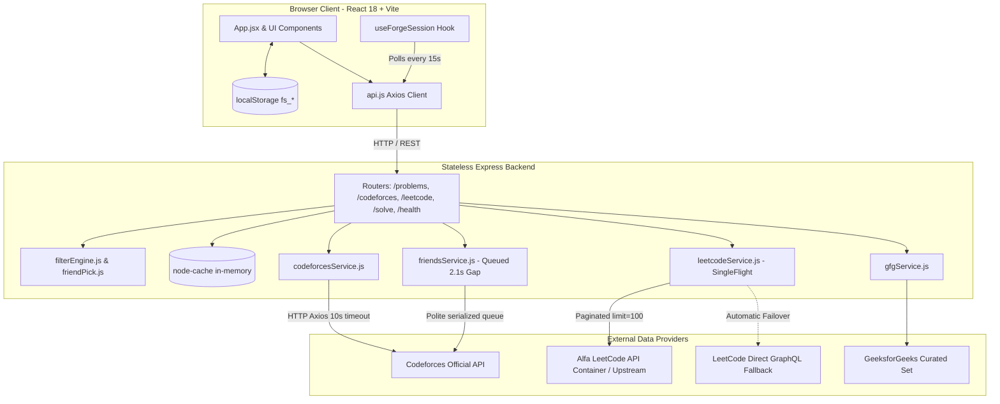
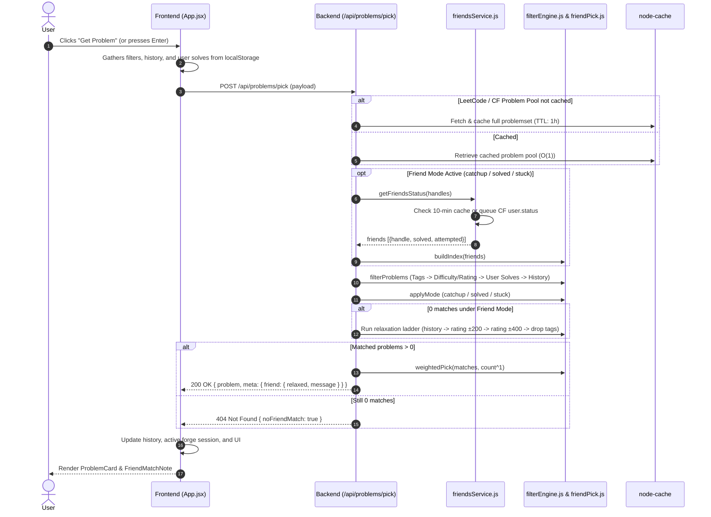

# SolveForge Architecture & System Design

This document details the architecture, design principles, data flow, caching lifecycle, and runtime mechanics of **SolveForge**.

---

## 1. High-Level Architecture

SolveForge is engineered as a decoupled two-tier application with an external third-party competitive programming API ecosystem:

---

## 2. Core Design Principles

### Stateless Backend
- **No Database**: The backend does not maintain a database (PostgreSQL, MongoDB, Redis, etc.).
- **Zero Server Sessions**: All user personalization state is transmitted by the client in request payloads or stored in client-side storage.
- **Reverse Proxy Compatibility**: Configured with `app.set('trust proxy', 1)` to correctly inspect client IPs behind Render and Vercel reverse proxies.
- **RFC-Compliant Rate Limiting**: Global ceiling of **120 requests/minute per client IP** using `express-rate-limit` draft-7 headers, preventing denial of service without blocking legitimate browsing.

### SingleFlight Request Deduplication
- Simultaneous concurrent requests for identical data are coalesced into a single in-flight promise:
  - **LeetCode Problem Set**: `inFlightFetchPromise` deduplicates background pagination sweeps.
  - **User Solved Slugs**: `inFlightUserSolved` Map prevents duplicate calls when React mounts or profile screens load.
  - **User Stats**: `inFlightUserStats` Map deduplicates parallel analytics calls.

### Resilient Degradation & Fallbacks
- **Polite Codeforces Queue**: `friendsService.js` enqueues requests with a 2,100ms delay (`CF_REQUEST_GAP_MS`) to respect Codeforces' rate limit (≤ 1 req/2s).
- **Graceful LeetCode Fallback**:
  1. Primary: Paginated fetch from Alfa LeetCode API (`limit=100` up to 6,000 problems).
  2. Secondary: Direct LeetCode GraphQL query for problem list.
  3. Tertiary: Offline snapshot of 3,320 problems with 300s TTL.
  4. Quaternary: Curated 53-problem static set with 30s TTL.
- **Non-Destructive Friend Relaxation**: When friend filters yield 0 matches, the query automatically loosens secondary criteria (history, rating bands, tags) without dropping the friend filter.

---

## 3. Data Flow & Filter Pipeline

The central problem discovery endpoint is `POST /api/problems/pick`.

### Filter Evaluation Sequence
1. **Tags**: OR-logic matching across problem tag arrays (case-insensitive).
2. **Difficulty / Rating**: Codeforces rating range (`[minRating, maxRating]`) OR platform difficulty label (`easy`, `medium`, `hard`).
3. **LeetCode Solved Sets**: Filter by `excludeUserSolvedSlugs` or `showOnlyUserSolvedSlugs` (show-only takes precedence if both present).
4. **History**: Exclude problem IDs present in `history`.
5. **Codeforces Solved Sets**: Filter by `excludeUserSolved` or `showOnlyUserSolved`.
6. **Friend Filtering**: Applied post-filter via `friendPick.js`:
   - `catchup`: Requires `solvedBy.has(id)` AND `!mine.has(id)`.
   - `solved`: Requires `solvedBy.has(id)`.
   - `stuck`: Requires `stuckBy.has(id)` (attempted without AC).
7. **Weighted Selection**: Probability proportional to number of friends who solved/attempted the problem.

---

## 4. Live Submission Tracking & Forge Session

Live submission tracking is managed collaboratively between the client and backend:
1. When a problem is picked and the user begins practice, `useForgeSession` is initialized with `{ problem, handle, platform }`.
2. The client polls `GET /api/solve/check` every 15 seconds (first poll after 8 seconds).
3. The backend inspects recent submissions:
   - **Codeforces**: Queries `user.status` (count 30) to identify accepted solutions and count failed attempts since session start.
   - **LeetCode**: Queries `acSubmission` (limit 20) via Alfa API to detect recent AC timestamp.
4. **Grading & Armory**:
   - Time elapsed + failed attempt count determine the blade grade: **Rough**, **Tempered**, **Fine**, or **Masterwork**.
   - Upon acceptance, the completed blade is added to the user's permanent Armory in `localStorage` (`fs_armory`).

---

## 5. Caching Strategy & TTLs

| Cache Key | Content | TTL | Storage |
|---|---|---|---|
| `cf_problemset` | Complete Codeforces problem catalog (~9,000+ problems) | 1 hour (`CACHE_TTL_SECONDS`) | Backend In-Memory |
| `leetcode_problemset` | Complete free LeetCode problem catalog (~3,320 problems) | 1 hour (`LEETCODE_CACHE_TTL_SECONDS`) | Backend In-Memory |
| `friends_status_<handle>` | Per-friend Codeforces solved & attempted ID sets | 10 minutes (`FRIENDS_CACHE_TTL_SECONDS`) | Backend In-Memory |
| `lc:user:<username>` | LeetCode user solved problem slugs | 10 minutes (`LEETCODE_USER_CACHE_TTL_SECONDS`) | Backend In-Memory |
| `lc:stats:<username>` | LeetCode user profile analytics & tag distribution | 10 minutes (`LEETCODE_USER_CACHE_TTL_SECONDS`) | Backend In-Memory |
| `fs_history` | History of picked problem IDs | Persistent (max 200 items) | Client LocalStorage |
| `fs_armory` | Forged weapon collection and grades | Persistent (max 60 items) | Client LocalStorage |
| `fs_forge_session` | Active practice problem, start timestamp, and state | Persistent across page reloads | Client LocalStorage |

> **Immutability Contract**: All backend cache entries use `useClones: false`. Objects returned from `cache.get()` must **never be mutated directly**. Always create copies (`[...problems]`) before sorting or filtering.
