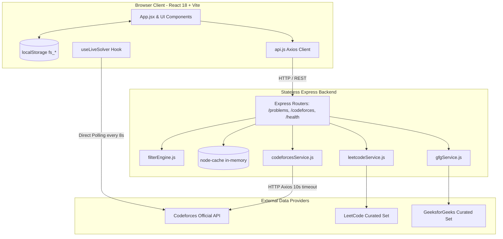
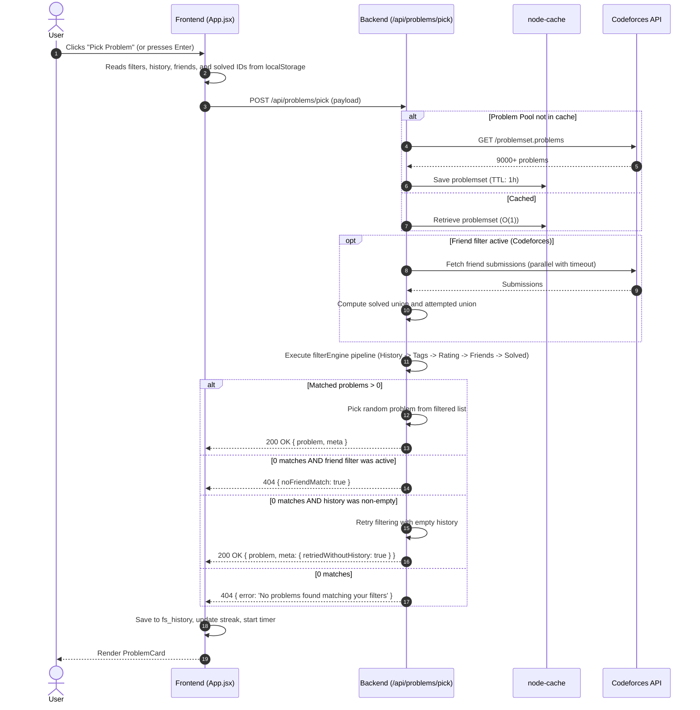

# SolveForge Architecture & System Design

This document details the architecture, design principles, data flow, and runtime mechanics of **SolveForge**.

---

## 1. High-Level Architecture

SolveForge is structured as a decoupled two-tier application with an external third-party API ecosystem:

---

## 2. Design Principles

### Stateless Backend
- **No Database**: The backend does not maintain a database (PostgreSQL, MongoDB, SQLite, etc.).
- **Zero Session State**: All requests are idempotent and self-contained. The client transmits all relevant filter state (history, solved IDs, friend handles, rating constraints) in request bodies.
- **In-Memory Caching**: Heavy external calls (like CF's 9,000+ problem set) are cached in memory using `node-cache` to ensure sub-millisecond response times for client requests.

### Client-Owned State
- All user personalization (Codeforces handle, verified solved problems, friend lists, streak counts, history, selected filters) is stored in the user's browser `localStorage`.
- No user accounts, passwords, or authentication servers are required.
- Fast, private, and zero server maintenance cost.

### Resilient Degradation
- **Network Timeouts**: External requests have strict 8-10 second timeouts to avoid hung requests.
- **Parallel Friend Queries**: `Promise.allSettled()` collects friend data; if one friend handle fails (e.g. invalid handle or CF rate limit), other friends' data is still utilized.
- **Fallback Problem Card**: If the backend is unreachable during problem re-attempts, the frontend constructs a fallback problem directly from the ID (e.g. `1900-B` -> `https://codeforces.com/problemset/problem/1900/B`).

---

## 3. Data Flow & Filter Engine

The central operation is `POST /api/problems/pick`. Here is the exact lifecycle of a pick request:

---

## 4. Live Submission Tracking Mechanics

To track when a user solves a problem without placing burden on the backend:
1. When a Codeforces problem is active and a user handle is configured, `useLiveSolver` engages.
2. It polls `https://codeforces.com/api/user.status?handle=<HANDLE>&from=1&count=5` directly from the user's browser every 8 seconds.
3. It checks for:
   - `verdict === 'OK'`
   - `creationTimeSeconds >= startTime` (recorded when tracking started)
   - `${sub.problem.contestId}-${sub.problem.index} === problemId`
4. State is stored in `localStorage.live_solve_state`. If the user reloads the browser, polling immediately resumes seamlessly.
5. On AC detection, the timer auto-stops and the solved celebration displays.

---

## 5. Caching Strategy & TTLs

| Cache Key | Content | TTL | Location |
|---|---|---|---|
| `cf_problemset` | Full Codeforces problem set (~9,000+ problems) | 1 hour (`CACHE_TTL_SECONDS`) | Backend Memory |
| `cf_user_status_<handle>` | User submission set (solved & attempted) | 10 minutes (600s) | Backend Memory |
| `stats_<handle>` | Computed user statistics, tags, ratings | 10 minutes (600s) | Backend Memory |
| `fs_user_solved_ids` | Local list of user solved IDs | 10 minutes | Client LocalStorage |
| `fs_history` | History of picked problem IDs | Persistent (max 200) | Client LocalStorage |

> **Note on Immutability**: All backend cache entries use `useClones: false`. Objects returned from `cache.get()` must **never be mutated in-place**.

